<p align="center">
  
</p>

<p align="center">
  <a href="#try-it-in-5-minutes">Try it in 5 minutes</a> ·
  <a href="#how-it-works">How it works</a> ·
  <a href="#see-it-catch-something">See it catch something</a> ·
  <a href="docs/guides/authoring-spec-files.md">Docs</a>
</p>

## The problem

You ask an AI agent to add refunds to your payment service. It writes clean code, the tests pass, the pull request looks fine. Two weeks later, finance finds a refund larger than the payment it refunded.

The rule was written down: in a design doc, in `CLAUDE.md`, in a comment. The agent read it three sessions ago, or never found it. Nothing failed, so nobody noticed.

This isn't a problem with the model. It's a problem with where your rules live. Today, the knowledge that matters sits in places that nothing enforces:

- **Prompts and context files** (`CLAUDE.md`, `AGENTS.md`, skill files) are advice. An agent can misread them or skip them, silently.
- **Docs and wikis** drift away from the code, and nothing breaks when they do.
- **Traceability** (which requirement has a test, which rule is enforced where) is a spreadsheet someone updates by hand, until they stop.
- **Every session starts from zero.** The agent re-reads dozens of files to rediscover what you meant, and still guesses.

The more work you give to AI, the worse this gets. It writes faster than anyone can review.

## The idea: hard skills, not soft skills

There are two ways to teach an AI how your team works.

A **soft skill** is advice placed in the AI's context: a prompt, a `CLAUDE.md`, a skill file. It helps, but it's prose. The AI may follow it, or not.

A **hard skill** is a rule that a program enforces. The AI can't skip it, because the check fails.

<p align="center">
  
</p>

|  | Soft skill<br>prompt, `CLAUDE.md`, skill file | Hard skill<br>SpecForge extension |
|---|---|---|
| Lives in | The AI's context window, as prose | A compiler, as code |
| Can the AI ignore it? | Yes, silently | No: the check fails |
| Same verdict twice? | Not always | Always. There's no AI inside |
| Knows what's missing? | No | Yes: broken links, unenforced rules, unproven promises |
| Shared how? | Copied between files | Versioned and installed, like a library |

**SpecForge is a tool for hard skills.** You (or more often, your agent) write down what must be true in small, structured `.spec` files. SpecForge checks them the way a compiler checks code: every reference must point to something real, every rule must be enforced by something, every promise must be proven by a test. Then it gives the checked result to your agent as context.

Think of it as **a type checker for what you mean**.

## How it works

<p align="center">
  
</p>

1. **You describe what you want**, in conversation, as you do today.
2. **Your agent drafts the spec**: the operations, the rules that must always hold, the events, and for each one, what proves it.
3. **SpecForge checks the draft.** Typos, rules nobody enforces, missing pieces: the check fails with the exact line and a fix hint, and the agent corrects it. No AI is involved in this step. Same input, same verdict, every time.
4. **Your agent builds against the checked spec.** It asks SpecForge for the exact slice it needs, instead of re-reading your repository.
5. **Your tests prove the spec.** Each test names what it proves. `specforge collect` runs them and records what is proven and what isn't.
6. **You review.** Instead of reading every line the agent wrote, you read what was promised, what is proven, and what is still open.

## See it catch something

Your agent drafts this for the refund feature:

```spec
invariant refund_within_capture "Refunds never exceed the captured amount" {
  risk high
  verify unit "rejects a refund larger than the captured amount"
}

invariant refund_needs_reason "Every refund records a reason" {
  guarantee "A refund without a reason is rejected"
  risk      medium
  verify unit "rejects a refund with no reason"
}

behavior issue_refund "Refund a captured payment" {
  category   command
  invariants [refund_within_capture]
  produces   [refund_isued]
  contract   "Given a captured payment, refunds up to the captured amount"
  verify unit "refunds the requested amount"
}

event refund_issued "A refund was issued" {
  verify unit "is emitted once per refund"
}
```

It reads fine. Here is what `specforge check` says:

<p align="center">
  
</p>

<details>
<summary>The same output as text</summary>

```text
[E003] Error: unresolved reference 'refund_isued' in entity 'issue_refund'
    ╭─[ refunds.spec:15:15 ]
 15 │   produces   [refund_isued]
    │ Help: did you mean 'refund_issued'?

[W003] Warning: invariant 'refund_needs_reason' is not enforced by any behavior
[W007] Warning: event 'refund_issued' is not produced by any behavior
[E006] Error: invariant 'refund_within_capture' is missing required field 'guarantee'

2 errors, 2 warnings, 0 infos
```

</details>

Four problems a human reviewer would probably miss:

| Code | What it found | Why it matters |
|---|---|---|
| `E003` | A one-letter typo in an event name | The refund code would publish an event nobody listens to |
| `W003` | A rule that nothing enforces | In a doc, this rule would just sit there. Here, it's a warning until something enforces it |
| `W007` | An event that nothing produces | The same typo, seen from the other side |
| `E006` | A rule with a name but no guarantee | "Refunds never exceed the captured amount" isn't checkable until it says *what* never exceeds *what* |

Errors always fail the check. Warnings fail it too with `specforge check --strict`, which is what you run in CI.

The agent fixes all four and runs the check again: `0 errors, 0 warnings, 0 infos`. The spec is now consistent, but nothing is *proven* yet. That's the tests' job: each test names the promise it proves, `specforge collect` runs them, and `specforge review` shows what's covered and what's still open.

<p align="center">
  
</p>

Every rule you just saw came from an extension, not from SpecForge itself (see [Hard skills are extensions](#hard-skills-are-extensions)).

## Try it in 5 minutes

**1. Install.** SpecForge is a single binary with no dependencies.

```bash
curl -fsSL https://raw.githubusercontent.com/leaderiop/SpecForge/main/install.sh | sh
```

<details>
<summary>Other ways to install</summary>

```bash
# Homebrew (once the tap is published)
brew install leaderiop/tap/specforge

# Prebuilt binary via cargo-binstall
cargo binstall --git https://github.com/leaderiop/SpecForge specforge-cli

# From source (stable Rust toolchain)
git clone https://github.com/leaderiop/SpecForge && cd SpecForge
cargo install --path crates/surfaces/cli
```

Prebuilt archives for macOS, Linux and Windows are on the [Releases page](https://github.com/leaderiop/SpecForge/releases). Formal proofs (`@specforge/formal`) also need the [`z3`](https://github.com/Z3Prover/z3) solver on your `PATH`; everything else works without it.

</details>

**2. Create a project** in your repository:

```bash
specforge init --extensions @specforge/software
```

This writes a `specforge.json` and a first file in `spec/`. In a Cargo or vitest project, it also turns on the matching test runner.

**3. Connect your agent.** SpecForge speaks [MCP](https://modelcontextprotocol.io), so any MCP client can read and check your spec. Use an absolute path:

```bash
claude mcp add specforge -- specforge mcp /path/to/your/project
```

<details>
<summary>Other MCP clients</summary>

```json
{
  "mcpServers": {
    "specforge": { "command": "specforge", "args": ["mcp", "/path/to/your/project"] }
  }
}
```

</details>

**4. Ask your agent for a spec.** For example:

> Write a spec in `spec/` for the refund feature: the behavior, the rules it must never break, the events it emits, and what proves each one. Validate it with the SpecForge tools and fix every error before you show it to me.

**5. Read the result yourself.**

```bash
specforge check     # is the spec consistent?
specforge review    # what is still unproven?
```

**6. Link your tests.** Each test says which entity it proves. In Rust (with the [`specforge-test`](docs/guides/rust-test-tracing.md) crate):

```rust
use specforge_test::prelude::*;

#[specforge_test(behavior = "issue_refund", verify = "refunds the requested amount")]
fn refunds_the_requested_amount() { /* ... */ }
```

In vitest:

```ts
test('refunds the requested amount',
  { meta: { specforge: { behavior: 'issue_refund', verify: 'refunds the requested amount' } } },
  () => { /* ... */ })
```

Then run `specforge collect`. It asks once before running your test command, and records what each test proves. See the [Rust](docs/guides/rust-test-tracing.md) and [vitest](docs/guides/vitest-test-tracing.md) guides.

## Do I have to learn a new language?

You'll want to **read** it, because the spec is what you approve. You rarely need to **write** it: your agent writes and fixes the files, and the check tells it when it's wrong.

It's built to be easy to read. Each block is one thing, with a kind, a name, a title, and fields, like a filled-in form:

```spec
invariant refund_within_capture "Refunds never exceed the captured amount" {
  guarantee "The sum of refunds on a payment never exceeds the captured amount"
  risk      high
}
```

To write specs by hand, start with the [authoring tutorial](docs/guides/authoring-spec-files.md) and the [worked example](examples/todo-app/).

## How is this different from…

| You already use | It's good at | What SpecForge adds |
|---|---|---|
| `CLAUDE.md`, `AGENTS.md`, skill files | Telling an agent how to behave | Rules a program checks, not advice the agent may skip |
| Specs and PRDs in Markdown | Describing intent for people and agents | Structure that is validated: broken references, missing pieces and unproven promises fail the check |
| Tests | Proving the code does something | Saying *which* promise each test proves, and which promises have no test at all |
| Issue trackers | Tracking work in progress | Tracking what the system must do, and whether that's proven |
| Requirements tools (DOORS, Polarion) | Traceability for regulated teams | Plain text in your repository, checked in CI, readable by agents, extensible by you |
| Code generators | Writing code from a model | Nothing. SpecForge never writes your code. Your agent does, from intent SpecForge has checked |

## Hard skills are extensions

SpecForge itself knows nothing about payments, software, or any other field. Every word in a spec (`behavior`, `invariant`, `event`) and every rule ("an invariant must be enforced by a behavior") comes from an **extension**. An extension is a hard skill packaged as code: a vocabulary, plus the rules that judge it.

<p align="center">
  
</p>

These ship inside the binary:

| Extension | What it lets you describe |
|---|---|
| `@specforge/software` | Behaviors, the rules they must keep (invariants), events, types, and interfaces (ports) |
| `@specforge/product` | Features, personas, journeys, milestones, releases, and your team's vocabulary |
| `@specforge/governance` | Decisions, constraints, and failure modes |
| `@specforge/formal` | Properties and axioms that an SMT solver proves or refutes |
| `@specforge/cargo-test`, `@specforge/vitest` | Which of your tests prove which entities |

Turn one on with `specforge add @specforge/product`. The full list is in the [extension inventory](docs/extension-inventory.md). To write your own hard skill, see [Extending SpecForge](docs/guides/extending-specforge.md).

## Where this is going

Software comes first because it's where AI writes the most today. But the engine has no built-in domain, on purpose. It's built for any field where expertise has rules and mistakes are expensive: regulated software (IEC 62304, GAMP 5), pharmaceutical quality (batch release, deviations), safety engineering. In those fields, "AI drafts, the hard skill checks, a qualified person signs" isn't a slogan. It's how the work has to be done. Extensions for these domains are in development; they aren't builtins yet.

Also planned: agents that edit the spec through typed operations, so nobody (human or AI) writes `.spec` text by hand.

## What SpecForge is not

- **Not an AI.** It makes no model calls. It's a deterministic compiler, written in Rust.
- **Not a code generator.** It checks intent. Your agent writes the code.
- **Not a test framework.** Your tests stay in `cargo test` or vitest. SpecForge runs them only after you approve the command, and records what they prove.

## Learn more

- **[Authoring tutorial](docs/guides/authoring-spec-files.md)**: writing `.spec` files from zero, with a [worked example](examples/todo-app/), a [cookbook](docs/guides/spec-cookbook.md), [best practices](docs/guides/spec-best-practices.md) and [troubleshooting](docs/guides/spec-troubleshooting.md).
- **[Test tracing for Rust](docs/guides/rust-test-tracing.md)** and **[for vitest](docs/guides/vitest-test-tracing.md)**: link tests to the entities they prove.
- **[Formal verification](docs/guides/formal-verification.md)**: specs an SMT solver checks, with counterexamples at exact locations.
- **[Quick reference](docs/quick-reference.md)**: every command, entity kind and diagnostic code on one page.
- **[Vision](docs/vision/README.md)**: the manifesto, [principles](docs/vision/principles.md) and [north star](docs/vision/north-star.md).
- **[Architecture](ARCHITECTURE.md)** and **[Contributing](CONTRIBUTING.md)**: how SpecForge is built, and how to work on it.
- **[Documentation hub](docs/README.md)**: entity reference, traceability chain and research.

## License

Licensed under either of [Apache License, Version 2.0](LICENSE-APACHE) or [MIT license](LICENSE-MIT) at your option.
